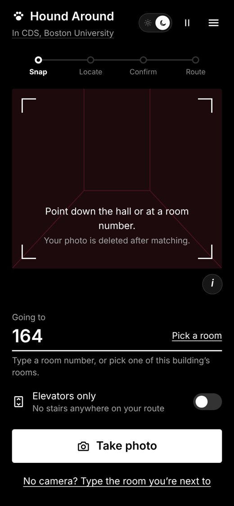
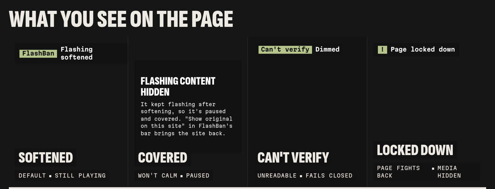

### hey, I'm Avery 👋

I study **Statistics + Computer Science** at Boston University (Kilachand Honors College), and I like building software that gets people where they're going, whether that's down the right hallway or safely past a strobing webpage. This fall my teams shipped two projects at two hackathons, and both won.

- 🧭 &nbsp;Building web apps, browser extensions, and the tests that keep them honest
- 🐶 &nbsp;Currently: something new — it lands here this month
- 📦 &nbsp;Up next: incoming SWE at Amazon
- 🎲 &nbsp;Fun fact: I got into stats because of a Galton board. Bounce a ball left or right at random 16 times, do it a few hundred times, and you *still* get a bell curve. Still blows my mind.

---

### 🏆 Things I've shipped

<table>
<tr>
<td valign="top">

#### [Hound Around](https://github.com/DxubleBTW/Hound-Around)
🥇 *Best Use of BU Libraries Resources, DS+X Hackathon 2026*

GPS gives up indoors. Snap one photo of a hallway and Hound Around figures out where you are inside BU's computing & data sciences building, then routes you to your room, with an elevators-only mode for a step-free path.

**My part:** the React phone app, plus the spec, steering docs, and agent hooks that kept five people's work in sync.

`0.6–0.7 s` to place a photo · `84.1%` of test photos end at the right spot · `172` backend tests

React · Vite · Tailwind · FastAPI · PyTorch · networkx

[**Try it**](https://www.hound-around.tech) · [Devpost](https://devpost.com/software/hound-around)

</td>
</tr>
<tr>
<td valign="top">

#### [FlashBan](https://github.com/dribeiro0/FlashBan)
🥇 *Winner, Tech Access track, Hackcessability 2026*

A Chrome extension that catches flashing video, images, and animations, then dims, freezes, or blocks them before they reach your eyes. Built for people with photosensitive epilepsy, and it treats a strobing page as both an accessibility barrier *and* an attack.

**My part:** the extension core and its safe mode.

`16 / 16` attack pages stopped · `0 / 8` everyday pages falsely flagged · `< 0.4 ms` per frame · `180` unit tests

JavaScript · Chrome Manifest V3 · Canvas 2D · WebGL · Node.js

[**Visit the site**](https://flashban.vercel.app) · [Devpost](https://devpost.com/software/flashban)

</td>
</tr>
</table>

### 🔬 Also: a little research

Summer 2026 at **Columbia's Data Science Institute**, I ran an independent study of 10,000 LendingClub loans to see whether interest rate and credit grade predict early repayment trouble. Spoiler: both do (p < .001). [Read the notebook →](https://github.com/DxubleBTW/averylee-lendingclub-loan-analysis)

### 🧰 What I reach for

<b>🎤 Stages & shout-outs</b> (click to expand)

 

**On stage**
- Keynote, Inspire Momentum Conference, Orlando (Jun 2026)
- Panelist, NSBE National Convention, Baltimore (Mar 2026)
- Panelist, NASEM Future of Youth Development summit, Washington, DC (Oct 2025)
- Delaware Youth Ambassador for STEMNEXT (2025–2026)

**Recognition**
- University of Delaware EntreX Pitch Competition Winner
- Diamond Challenge International Finalist
- QuestBridge National College Match Recipient
- Amazon Future Engineer Scholar
- Fulton Bank Empower Scholar (Summer 2026)

### 📬 Say hi

Always up for a hackathon team, a research question, or hearing about what you're building.

<!-- last updated: Nov 2026 -->
