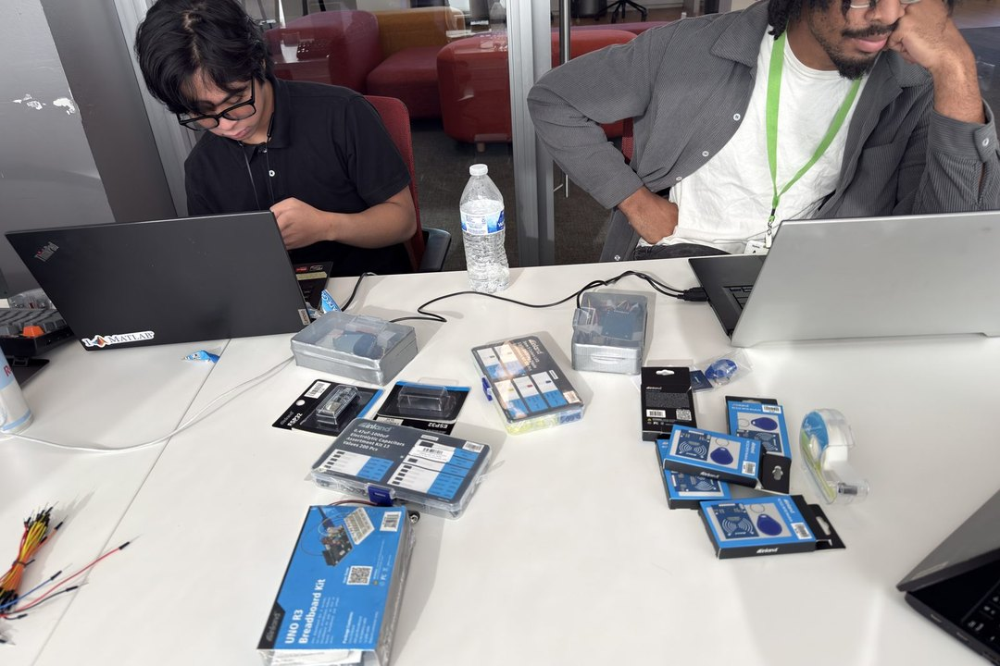
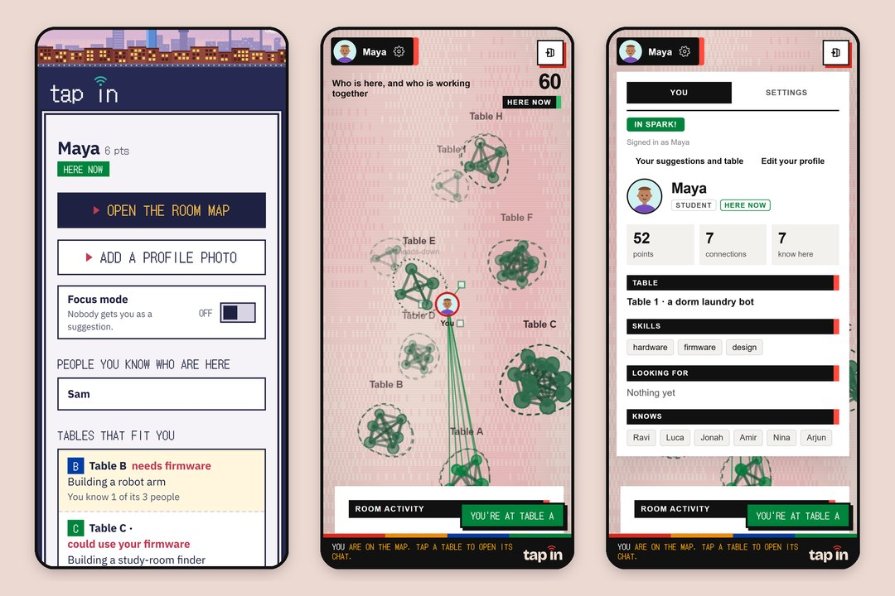
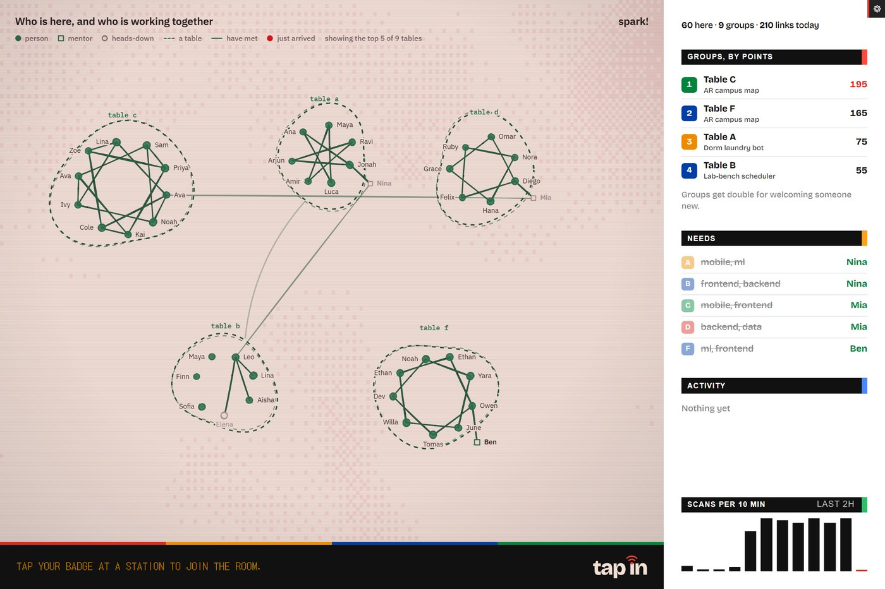
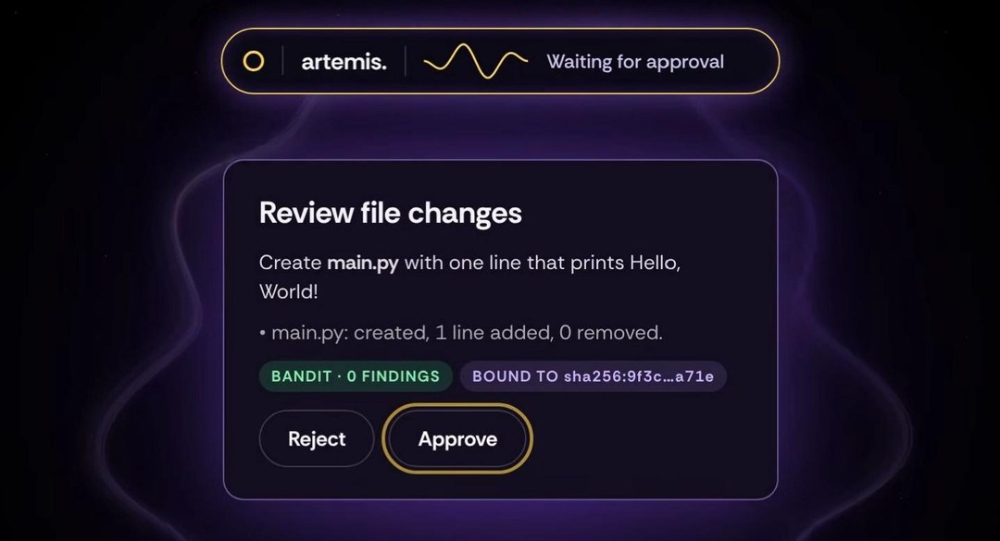
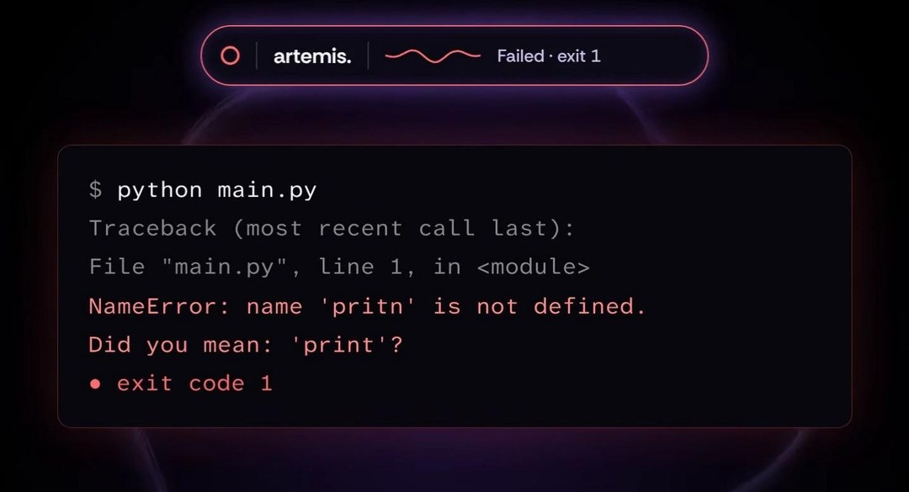
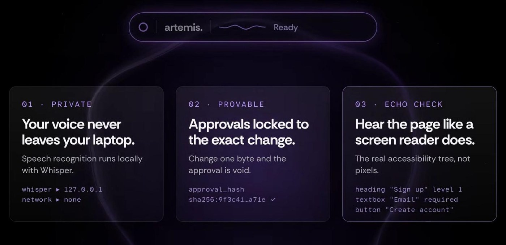
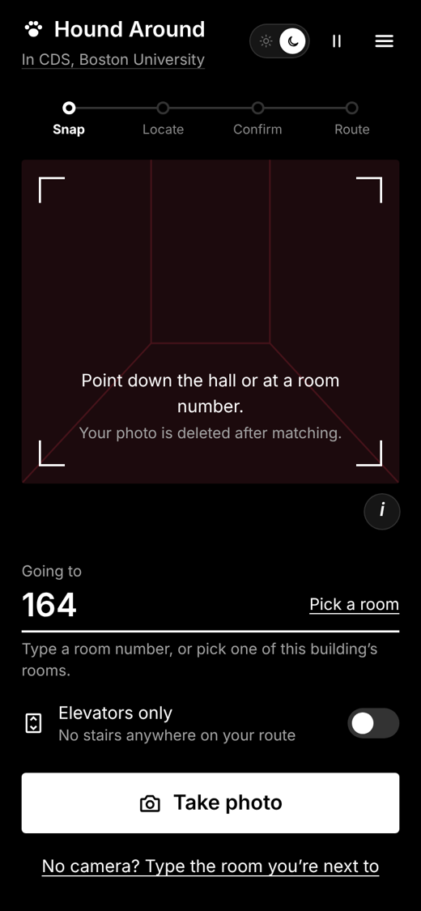
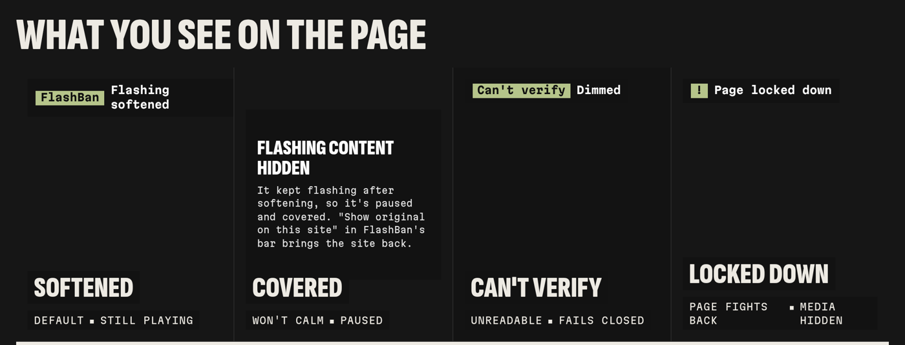

### hey, I'm Avery 👋

I study **Statistics + Computer Science** at Boston University (Kilachand Honors College), and I like building software that gets people where they're going, whether that's down the right hallway, safely past a strobing webpage, through a codebase without ever looking at the screen, or over to the table that needs you. This fall my teams shipped four projects at four hackathons, and all four won.

- 🧭 &nbsp;Building web apps, browser extensions, voice tools, and the tests that keep them honest
- 🐶 &nbsp;Currently: building the next one (there's always a next one)
- 📦 &nbsp;Up next: incoming SWE at Amazon
- 🎲 &nbsp;Fun fact: I got into stats because of a Galton board. Bounce a ball left or right at random 16 times, do it a few hundred times, and you *still* get a bell curve. Still blows my mind.

---

### 🏆 Things I've shipped

<table>
<tr>
<td valign="top">

<a href="https://tapin.boston"><picture><source media="(prefers-color-scheme: dark)" srcset="assets/tapin-logo-dark.png"></picture></a>

#### [Tap In](https://github.com/BU-Hackathonz/TapIn)
🥇 *Best Use of Tiger Data, BostonHacks 2026*

Walking into a room full of students doesn't tell you who to sit with. With Tap In, you tap your badge at a station when you arrive, and the wall display and your phone show who you already know there and which tables could use your skills. Walk over, tap in together, and you're part of the group, with points for every new person you meet.

Every tap is time-series data, so it all lives in Tiger Data (TimescaleDB): raw taps and scans go into hypertables, and real-time continuous aggregates keep the live stats on the wall current without rescanning rows.

**My part:** the badge stations (ESP32 and RC522 readers, their firmware and enclosures), the live stats and leaderboard on Tiger Data's continuous aggregates, and the Devpost write-up.

`259 ms` median tap-to-reply · `40-min` station soak with zero failed polls · `115+` PRs merged in about 24 hours

 

Python · FastAPI · Tiger Data (TimescaleDB) · ESP32 · Arduino · Gemini API

[**Visit the site**](https://tapin.boston)

</td>
</tr>
<tr>
<td valign="top">

<a href="https://heyartemis.boston"><picture><source media="(prefers-color-scheme: dark)" srcset="assets/artemis-logo-dark.png"></picture></a>

#### [Artemis](https://github.com/BU-Hackathonz/Artemis)
🥇 *Winner, Accessibility Track, HackUMass XIV 2026*

AI coding tools assume you can see the diff. Artemis is a voice-first coding companion for blind developers: say what you want built, and it reads back what it heard, summarizes each change before you approve it, scans the code for security issues, then runs it and tells you exactly what happened, down to the exit code and the error line.

Speech recognition runs on your laptop, every approval is locked to the exact change you heard, and it works alongside the Orca screen reader on Ubuntu, so you never need sighted help.

**My part:** the approval gate, the Ubuntu desktop tools, and the speech layer that reads code and errors aloud.

`1,713` server tests · `217` client tests · `26` browser tests

 

Python · FastAPI · Claude API · faster-whisper · Playwright · GNOME Shell

[**Visit the site**](https://heyartemis.boston) · [Devpost](https://devpost.com/software/artemis-o149cr)

</td>
</tr>
<tr>
<td valign="top">

#### [Hound Around](https://github.com/DxubleBTW/Hound-Around)
🥇 *Best Use of BU Libraries Resources, DS+X Hackathon 2026*

GPS gives up indoors. Snap one photo of a hallway and Hound Around figures out where you are inside BU's computing & data sciences building, then routes you to your room, with an elevators-only mode for a step-free path.

**My part:** the React phone app, plus the spec, steering docs, and agent hooks that kept five people's work in sync.

`0.6–0.7 s` to place a photo · `84.1%` of test photos end at the right spot · `172` backend tests

React · Vite · Tailwind · FastAPI · PyTorch · networkx

[**Try it**](https://www.hound-around.tech) · [Devpost](https://devpost.com/software/hound-around)

</td>
</tr>
<tr>
<td valign="top">

#### [FlashBan](https://github.com/dribeiro0/FlashBan)
🥇 *Winner, Tech Access track, Hackcessability 2026*

A Chrome extension that catches flashing video, images, and animations, then dims, freezes, or blocks them before they reach your eyes. Built for people with photosensitive epilepsy, and it treats a strobing page as both an accessibility barrier *and* an attack.

**My part:** the extension core and its safe mode.

`16 / 16` attack pages stopped · `0 / 8` everyday pages falsely flagged · `< 0.4 ms` per frame · `180` unit tests

JavaScript · Chrome Manifest V3 · Canvas 2D · WebGL · Node.js

[**Visit the site**](https://flashban.vercel.app) · [Devpost](https://devpost.com/software/flashban)

</td>
</tr>
</table>

### 🔬 Also: a little research

Summer 2026 at **Columbia's Data Science Institute**, I ran an independent study of 10,000 LendingClub loans to see whether interest rate and credit grade predict early repayment trouble. Spoiler: both do (p < .001). [Read the notebook →](https://github.com/DxubleBTW/averylee-lendingclub-loan-analysis)

### 🧰 What I reach for

<b>🎤 Stages & shout-outs</b> (click to expand)

 

**On stage**
- Keynote, Inspire Momentum Conference, Orlando (Jun 2026)
- Panelist, NSBE National Convention, Baltimore (Mar 2026)
- Panelist, NASEM Future of Youth Development summit, Washington, DC (Oct 2025)
- Delaware Youth Ambassador for STEMNEXT (2025–2026)

**Recognition**
- University of Delaware EntreX Pitch Competition Winner
- Diamond Challenge International Finalist
- QuestBridge National College Match Recipient
- Amazon Future Engineer Scholar
- Fulton Bank Empower Scholar (Summer 2026)

### 📬 Say hi

Always up for a hackathon team, a research question, or hearing about what you're building.

<!-- last updated: Nov 2026 -->
